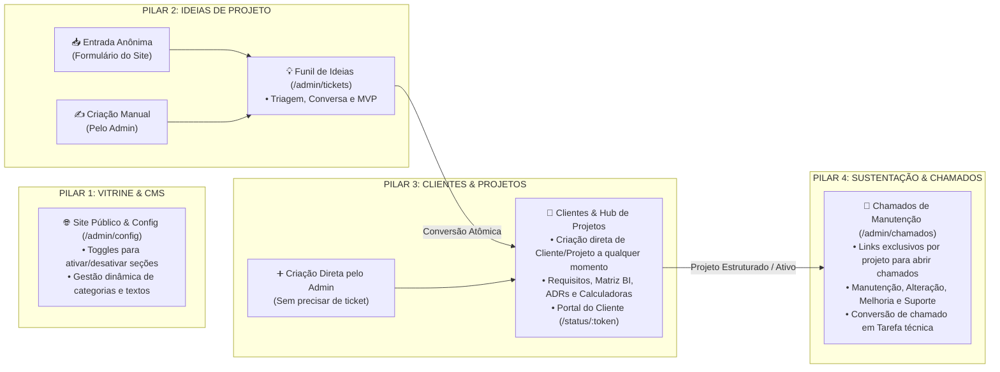

# 🏛️ Especificação Geral da Arquitetura (`site-pessoal-hub`)

> **Fonte Única da Verdade:** Este repositório utiliza uma arquitetura unificada 100% em TypeScript em Monorepo PNPM (`./client` em **Next.js + React 19** e `./app` em **NestJS + Prisma + PostgreSQL 17**), integrando **Vitrine de Portfólio de Alta Performance**, **CMS Visual com Feature Flags**, **Funil de Ideias de Projeto**, **CRM & Hub de Engenharia de Projetos (Requisitos, BI e Calculadoras)** e **Sistema de Chamados de Manutenção & Sustentação**.

---

## 🎯 Visão Geral dos 4 Pilares do Ecossistema

---

## 📂 Mapa da Documentação Organizada

Toda a documentação técnica detalhada está dividida nas pastas [`docs/back/`](file:///home/tanaka/dev/projetos/personal/site-portifolio/docs/back) e [`docs/front/`](file:///home/tanaka/dev/projetos/personal/site-portifolio/docs/front):

### 1. Backend (`./app` — NestJS 12 + Prisma ORM + PostgreSQL 17 em Arquitetura Modular Nativa)
- 📄 **[Documentação Completa do Backend (`docs/back/docs-backend.md`)](file:///home/tanaka/dev/projetos/personal/site-portifolio/docs/back/docs-backend.md)**
  - **Arquitetura Modular Nativa do NestJS (`src/module/*`):** Isolamento por módulos de domínio (`*.module.ts` + `*.controller.ts` + `*.service.ts` + `dto/` validados com **Zod**), com `Guards` centralizados para área pública, portal por token e admin.
  - **Segurança Blindada de Admin Solo (`AuthModule`):** Autenticação com Cookie HTTP-Only (`@nestjs/jwt` + `argon2`), segundo fator **2FA (TOTP)** e login sem senha por dispositivo físico via **Passkeys / WebAuthn (`@simplewebauthn/server`)** em `admin_dispositivos`.
  - **Módulos dos 4 Pilares:** `SiteConfigModule` (CMS + Feature Flags de seções), `TicketsModule` (Funil de Ideias anônimas e manuais + conversão atômica `prisma.$transaction`), `ClientesModule` & `ProjetosModule` (CRM com criação livre + Hub 360º), `EngenhariaModule` & `CalculadoraModule` (Requisitos, BI, ADRs e Calculadora Jr), `ChamadosModule` (Chamados de Manutenção pós-estruturação do projeto e conversão em Tarefa) e `FilaEsperaModule` (Fila FIFO).
  - Modelagem das **17 tabelas no PostgreSQL 17** (porta `15432`).
  - Especificação completa de todos os endpoints REST (`/api/auth`, `/api/public`, `/api/portal/:token` e `/api/admin/*`).
- 🗄️ **[Script SQL DDL (`docs/back/schema.sql`)](file:///home/tanaka/dev/projetos/personal/site-portifolio/docs/back/schema.sql)**
  - Script SQL puro com `ENUM`s, `CREATE TABLE` das 17 tabelas, chaves estrangeiras e índices de performance.

### 2. Frontend (`./client` — Next.js + React 19 + Tailwind CSS v4 + shadcn/ui + React Bits)
- 📄 **[Documentação Completa do Frontend (`docs/front/docs-frontend.md`)](file:///home/tanaka/dev/projetos/personal/site-portifolio/docs/front/docs-frontend.md)**
  - **Preservação 100% da Interface React construída:** Landing Page Pública (`/`), Portal do Cliente (`/status/[token]`) e Painel Admin estilo Hub/Torre de Controle (`/admin/*`) em Next.js App Router com Tailwind CSS v4, `shadcn/ui` e animações React Bits (`LogoLoop`, `StarBorder`, `RotatingText`, `BlurText`, `Magnet`).
  - **CMS Visual & Feature Flags (`/admin/config`):** Editor visual do `site-content.json`: ordem, visibilidade e presença no menu de cada seção da Home (`secoes`: Projetos, Serviços, Como trabalho, Depoimentos, Sobre, FAQ), conteúdo de serviços/processo/FAQ e categorias de tecnologias.
  - **Portal / Torre de Controle no Admin (`/admin`):** Dashboard modular conectando Ideias de Projeto, CRM de Clientes, Hub de Projetos (com Calculadoras, Requisitos e BI) e Central de Chamados de Manutenção.
  - **Links de Chamados por Projeto:** Interface para o cliente abrir e acompanhar chamados de manutenção/alteração diretamente pelo link do projeto (`/status/[token]`).
- 📋 **[JSON Base de Conteúdo, Feature Flags e Skills (`docs/front/site-content.json`)](file:///home/tanaka/dev/projetos/personal/site-portifolio/docs/front/site-content.json)**
  - Estrutura contendo perfil, ordem/visibilidade das seções (`secoes`), frases rotativas, serviços, processo, FAQ, carreira, missão, links sociais e catálogo categorizado de tecnologias.

### 3. Guia Mestre de Transferência, Clonagem e Prompt de Replicação
- 📦 **[Blueprint de Transferência e Prompt Mestre (`docs/BLUEPRINT_TRANSFERENCIA_E_PROMPT.md`)](file:///home/tanaka/dev/projetos/personal/site-portifolio/docs/BLUEPRINT_TRANSFERENCIA_E_PROMPT.md)**
  - Comandos diretos (`rsync` / `cp`) para transferir toda a estrutura do projeto.
  - Inventário completo do Design System (Tema Sálvia, tokens CSS, React Bits, DiceBear, Simple Icons e Admin).
  - **Prompt Mestre ("Copy & Paste")** pronto para qualquer IA replicar 100% do frontend atual e implementar o backend em **NestJS Modular + Prisma** com os 4 pilares.
